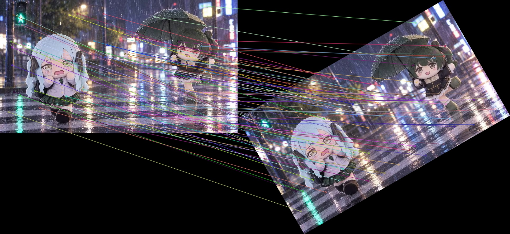
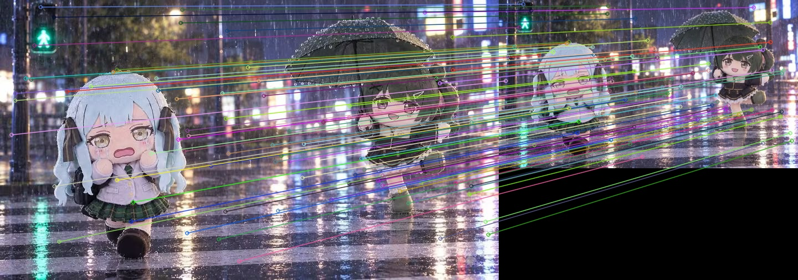
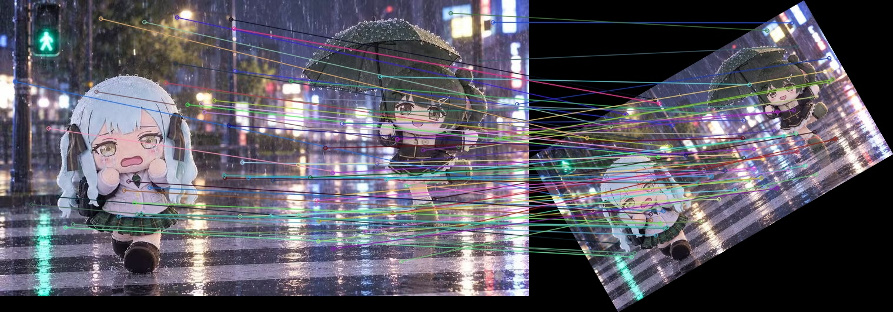

# 实验六：SIFT 特征提取与描述

## 1. 实验环境

- 运行环境：WSL Linux
- Python：3.12.14
- OpenCV：5.0.0
- 输入图像：data/photo01.jpg
- 图像尺寸：900 × 506，3 通道

## 2. SIFT 基本提取

使用 OpenCV 的默认 SIFT 参数检测关键点并生成描述子。

| 项目 | 实测结果 |
|---|---|
| 关键点数量 | 4364 |
| 描述子形状 | (4364, 128) |
| 描述子数据类型 | float32 |
| 关键点可视化 | results/l6_sift.jpg |

每个关键点对应一个 128 维描述子。描述子通过局部梯度方向直方图表征关键点附近的图像特征。

## 3. 参数对比实验

| 参数 | 设置 | 关键点数量 | 描述子维度 |
|---|---|---:|---:|
| nfeatures | 0（不限制） | 4364 | 128 |
| nfeatures | 500 | 500 | 128 |
| nfeatures | 1000 | 1000 | 128 |
| nfeatures | 2000 | 2001 | 128 |
| contrastThreshold | 0.01 | 8104 | 128 |
| contrastThreshold | 0.04（默认） | 4364 | 128 |
| contrastThreshold | 0.08 | 2065 | 128 |
| edgeThreshold | 5 | 3633 | 128 |
| edgeThreshold | 10（默认） | 4364 | 128 |
| edgeThreshold | 20 | 4623 | 128 |

### 参数分析

1. nfeatures 控制保留的高响应关键点数量。设置为 500 和
   1000 时，实际分别得到 500 和 1000 个关键点。
   设置为 2000 时，实际得到 2001 个，应保留实测结果。
   本次 OpenCV 5.0.0 环境下实测为 2001 个关键点。本实验保留实际运行结果，不对这 1 个关键点的差异作未经验证的推断。

2. contrastThreshold 从 0.04 降低至 0.01 时，关键点数由
   4364 增至 8104；提高至 0.08 时，减少为 2065。
   阈值越低，通常会保留更多低对比度特征。

3. edgeThreshold 从 10 降至 5 时，关键点数降为 3633；
   提高至 20 时，关键点数增至 4623。
   较大的 edgeThreshold 通常会减少对边缘型关键点的过滤。

参数对比 CSV：results/l6_parameter_comparison.csv

## 4. 旋转与尺度不变性验证

原图关键点数量：4364。

采用 BFMatcher、L2 距离及 Lowe ratio test，
阈值设为 0.75。全部描述子参与 KNN 匹配，
未按下标截断描述子数量。

匹配比例定义为：

匹配比例 = 通过 ratio test 的匹配数 / 原图关键点数量

| 实验 | 变换后关键点 | 通过 ratio test 的匹配数 | 匹配比例 |
|---|---:|---:|---:|
| 旋转 30° | 4927 | 2938 | 67.3% |
| 缩放 0.6 倍 | 2320 | 1707 | 39.1% |
| 旋转 30° + 缩放 0.6 倍 | 2347 | 1503 | 34.4% |

### 结果分析

旋转 30° 后的匹配比例为 67.3%，说明大量局部特征
在旋转后依然能够匹配，与 SIFT 利用关键点主方向
进行旋转对齐的设计相符。

缩小至 0.6 倍后，匹配比例为 39.1%。
缩放引起的分辨率与局部梯度变化会影响部分描述子。

在旋转与缩放同时发生时，匹配比例为 34.4%。
实验表明，该图像在综合变换后仍保留了可匹配的局部特征。

需要说明的是，ratio test 筛选出的匹配并不必然全部正确；
本实验的匹配比例是一个便于比较的指标，不等于几何验证
后的匹配准确率。

验证数据：results/l6_invariance_results.csv

## 5. 实验结论

本实验完成了 SIFT 关键点检测、128 维描述子生成、
参数对比以及旋转与尺度变化下的匹配实验。

结果表明，nfeatures、contrastThreshold 和 edgeThreshold
会影响关键点的数量。SIFT 在旋转 30°、缩小至 0.6 倍，
以及二者组合的情况下均获得了可观的匹配比例，
体现出一定的旋转与尺度鲁棒性。

## 6. 实验结果图与数据文件

### 6.1 SIFT 关键点可视化

图中圆圈表示关键点的尺度，方向线表示其主方向。

### 6.2 参数实验结果

参数对比数据：

[参数对比表 CSV](../results/l6_parameter_comparison.csv)

### 6.3 旋转与尺度不变性验证

旋转 30° 后的匹配图：

缩放至 0.6 倍后的匹配图：

旋转 30° 并缩放至 0.6 倍后的匹配图：

匹配数据：

[不变性验证结果 CSV](../results/l6_invariance_results.csv)

## 7. 实验提交文件

- 实验报告记录：docs/l6_experiment.md
- SIFT 模块：src/features.py
- 基础提取程序：src/l6_basic.py
- 参数实验程序：src/l6_params.py
- 不变性验证程序：src/l6_invariance.py
- 关键点可视化：results/l6_sift.jpg
- 参数对比数据：results/l6_parameter_comparison.csv
- 不变性验证数据：results/l6_invariance_results.csv