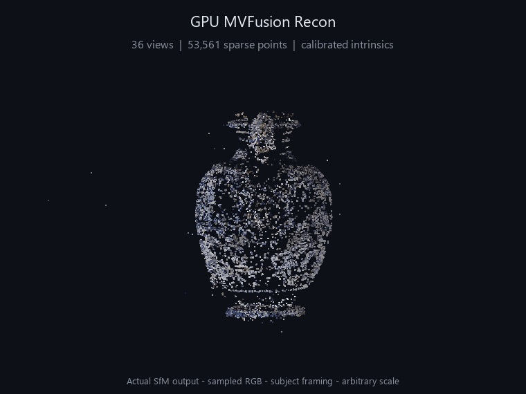
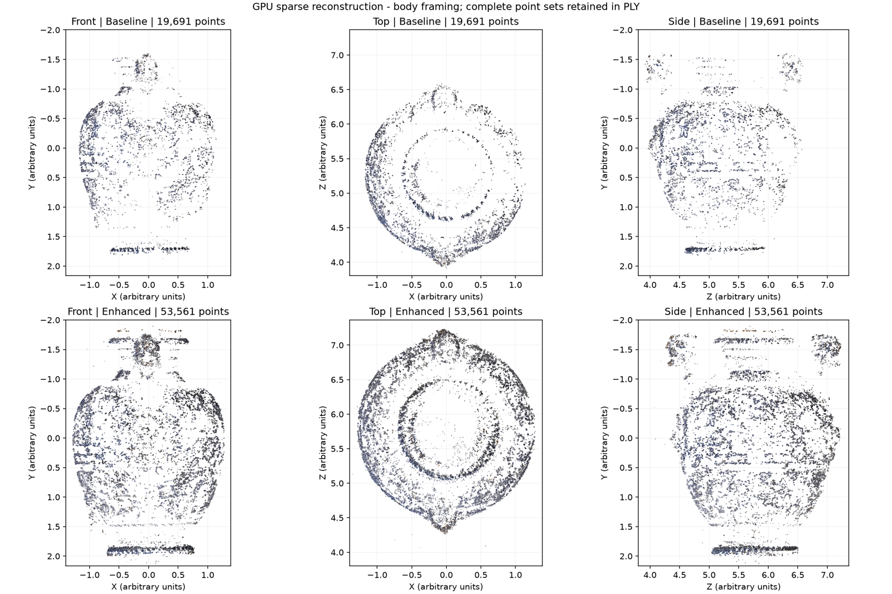
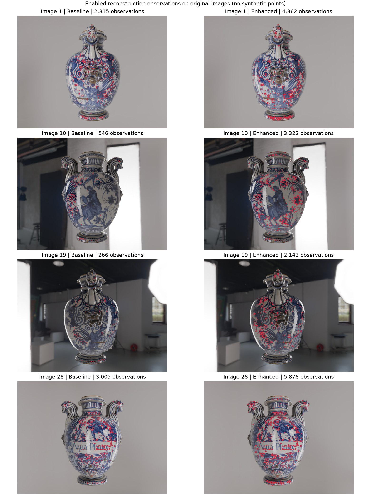

<p align="center">
  
</p>

<h1 align="center">C++17 / CUDA 增量式 SfM</h1>

<p align="center">
  
  
  
  
</p>
<p align="center">
  
  
</p>


本工程在 Windows x64、VS2022、CMake 上构建，使用项目内的 [OpenCV 4.12.0 动态库](third_party/opencv) CUDA 12.x。项目根目录是 `project_i`，Git 仓库在父目录。

目前已实现图像读取、CPU/GPU ORB、GPU 多图匹配、两视图几何验证、Track 构建、初始化、PnP 增量注册、三角化、CPU/GPU BA 和结果导出。只有一个正式应用 `project_i`；MVS 暂未实现。

## 重建效果

<p align="center">
  
</p>

<p align="center">
  <strong>36 / 36 张图像注册 · 53,561 个稀疏点 · 平均重投影误差约 0.50 px</strong>
</p>

动图来自固定标定内参后的 GPU 重建结果：每图 20,000 个特征，采用 GPU ORB、CUDA Hamming 匹配与 GPU BA。颜色采样自原始图像，采用主体取景，完整点云仍保留离群点；当前结果为 SfM 稀疏点云。

GitHub README 会过滤 JavaScript，因此这里使用可直接播放的旋转 GIF 展示三维结构；它不支持像交互查看器那样拖动旋转。静态截图与实验记录也一并保留。[GitHub 渲染规则](https://github.com/github/markup#github-markup)


### 标定基线与覆盖增强



| 配置 | 已注册图像 | 稀疏点数 | 三视图及以上支持点 |
| --- | ---: | ---: | ---: |
| 标定基线，10k 特征 / 图 | 36 / 36 | 19,691 | 8,411 |
| 覆盖增强，10k 特征 / 图 | 36 / 36 | 24,601 | 9,937 |
| 覆盖增强，20k 特征 / 图 | 36 / 36 | 53,561 | 22,279 |

### 有效观测覆盖



相对标定后的 10k 特征基线，20k 增强配置的平均有效观测覆盖格数（32 × 32 px）增加约 95%。该指标描述图像中的观测分布，不等同于物体表面积完整率。


完整配置、验证范围与复现命令见 [GPU 稀疏点云覆盖改进](docs/GPU稀疏点云覆盖改进.md)。上述展示资源存放在 `docs/assets/`，可以随仓库提交，不依赖被忽略的 `data/output/` 目录。

## 构建与验证

在项目根目录执行：

```powershell
cmake -S . -B build -A x64 -DBUILD_TESTING=ON
cmake --build build --config RelWithDebInfo --parallel 4
ctest --test-dir build -C RelWithDebInfo --output-on-failure
```

也可直接执行集成检查：

```powershell
.\build\RelWithDebInfo\project_i.exe --self-test
```

集成检查使用真实 CPU/GPU ORB 和 CUDA 匹配器，并通过确定性三视图特征验证几何、Track、PnP、三角化、BA 和增量缓存。合成场景的特征检测使用测试替身，因此这部分验证不代表真实照片的完整重建精度。测试需要可用的 CUDA GPU。

CMake 显式列出源文件；仅 BA 的自定义 kernel 文件按 CUDA 编译。保留原有 CUDA 架构配置，不强制覆盖 `CMAKE_CUDA_ARCHITECTURES`。应用构建后复制 OpenCV DLL；CUDA 运行库使用本机已安装 Toolkit 的 `bin` 路径。

## 运行

```powershell
.\build\RelWithDebInfo\project_i.exe --feature-backend cpu --ba cpu --output data/output/cpu .\data\image1.jpg .\data\image2.jpg
.\build\RelWithDebInfo\project_i.exe --feature-backend gpu --ba gpu --output data/output/gpu .\data\image1.jpg .\data\image2.jpg
```

### 使用已知内参与 GPU 覆盖配置

当前器物数据的标定已保存在 `configs/camera_vase.json`：`fx=3334.23, fy=3341.06, cx=2057.09, cy=1548.96`，无畸变，对应 4096×3072 原始图像。程序不缩放图像，也不优化这组内参；如输入图像经过缩放或裁剪，需同步转换内参。

```powershell
# 原算法 + 已知内参，用作对照；输出目录必须是新目录。
.\scripts\run_calibrated_sfm.ps1 -outputDirectory data/output/calibrated_baseline -featureCount 10000 -baseline

# GPU 空间均衡、描述子平滑、弱纹理检测与稳健三角化。
.\scripts\run_calibrated_sfm.ps1 -outputDirectory data/output/calibrated_coverage -featureCount 20000
```

也可直接传递 `--intrinsics 3334.23,3341.06,2057.09,1548.96`，它与 `--focal` 互斥。覆盖相关选项为 `--gpu-feature-grid 8x6`、`--gpu-orb-blur on`、`--fast-threshold 10`、`--robust-triangulation on`。未传这些选项时保留原有默认行为。

网格选择先检测两倍候选，再按空间单元轮流选取响应较好的特征；保留数量不超过 `--nfeatures`，并同步复制描述子行。它改善有可检测纹理区域的分布，不会在纯色区域凭空生成特征。稳健三角化先尝试原有全视图 DLT，失败后才用最多 64 个双视图假设寻找至少 60% 的一致观测。

本阶段目标为增加有效稀疏点和图像覆盖，不新增 MVS，也不为增点而放宽原有重投影阈值。

可追加第三张及后续图像。使用 `--help` 查看全部选项；`--focal 1600` 指定所有图像的焦距（像素），`--nfeatures 10000` 调整 ORB 数量，`--ratio 0.8` 指定比例阈值，`--ba none` 禁用 BA。默认应用提取最多 5000 个特征，底层配置仍保留原有默认值 50000。

输入应是同一静态场景的已去畸变图片。未指定焦距时，使用 `1.2 * max(width, height)` 并假设主点位于图像中心；这只是初始化估计。库接口允许为每张图像传入不同的 `Camera`。

退出码：`0` 表示所有输入图像已注册且达到最少初始点数；`1` 表示参数、依赖或运行错误；`2` 表示匹配流程运行结束但没有完整重建。两图成功只能说明两视图初始化成功，不能代表多图增量流程得到真实数据验证。

`data/` 当前 36 张器物视图已完成 GPU 增量重建验证。固定标定内参后，10k 特征基线生成 19,691 点；20k 特征覆盖增强生成 53,561 点，36/36 张全部注册，平均重投影误差约 0.50 px。覆盖指标、对照图和实现说明见 [docs/GPU稀疏点云覆盖改进.md](docs/GPU稀疏点云覆盖改进.md)。

## 数据契约与增量接口

- `FeatureSet` 独立保存图像 ID；连续的 32 字节 ORB 描述子第 `i` 行对应 `features_[i]`。使用 `wtaK=2` 与 Hamming 距离。
- `ImagePair` 固定采用较小 ID 在前的顺序。`PairwiseMatch::fromOrderedMatches` 在交换图像顺序时也交换特征索引；不要直接反转已附带位姿的边。
- `PairwiseMatch` 保存原始描述子匹配、尝试标记、几何状态和原始匹配数组中的内点索引。
- `IFeatureMatcher` 同时支持 `matchAllPairs`、`matchPairs` 和 `clearCache`。缓存比较描述子的完整内容，防止相同 ID 对应的新数据误用旧上传结果。接口按单线程使用。
- `TrackBuilder` 只使用已通过验证的内点，拒绝同图冲突，跳过重复连接；合并和压缩时同步更新三维点索引。两个已有三维点的 Track 不直接合并。
- `Observation` 保留原始特征索引和启用状态。PnP 精修后重新检查深度和误差；三角化检查正深度、视差和重投影误差；不足两个有效已注册观测的点会被移除。
- `IncrementalMapper` 接收应用注入的抽象提取器、匹配器和 BA；`addImage(image, camera, candidateIds)` 仅匹配新增图像与指定候选。空候选列表表示所有已有图像，旧边不会重新计算。

## 目标与依赖

`sfm_util` 提供公共类型；`sfm_geometry` 不依赖 scene；`sfm_scene` 表达数据与关联。特征、匹配和 BA 各自分成接口、实现和工厂目标。`sfm_mapper` 只依赖公共接口，`sfm_io` 负责读写，`sfm_app` 负责创建组件与配置，`src/main.cpp` 仅调用应用入口和处理异常。

CPU/GPU BA 共享后端无关的 LM/Schur 求解器，使用解析雅可比与 Huber 损失。GPU 实现将残差和雅可比计算交给 CUDA，矩阵装配和相机 Schur 求解仍在 CPU。两台初始相机固定，其他相机位姿与三维点共同优化，内参不优化。相机系统目前为稠密矩阵，最多支持 256 台可变相机。

原有 BA 文件为空且项目没有 Ceres，因此当前 CPU BA 使用原生求解实现，不是 Ceres 封装。旧的空 CPU matcher、GPU matcher `.cu`、未使用的 scene `.cpp` 和 CUDA 资源占位文件保留，但不参与构建。

## 输出

- `points.ply`：有效三维点，初始基线为 1 的任意尺度。
- `cameras.json`：图像注册状态、内参、位姿；采用 `X_camera = R * X_world + t`。
- `observations.csv`：Track、点、图像、特征索引、像素坐标和启用状态。
- `pairs.csv`：尝试状态、原始匹配数、几何内点数、验证状态。
- `matches.csv`：所有原始匹配及对应的几何内点标记。
- `inputs.txt`：图像 ID 与输入路径对应关系。

即使未重建成功，也导出匹配统计和未注册状态。输出默认位于 `output/reconstruction`；生成结果已加入忽略规则。

完整的实际构建记录、验证范围和限制见 [docs/工程报告.md](docs/工程报告.md)。
